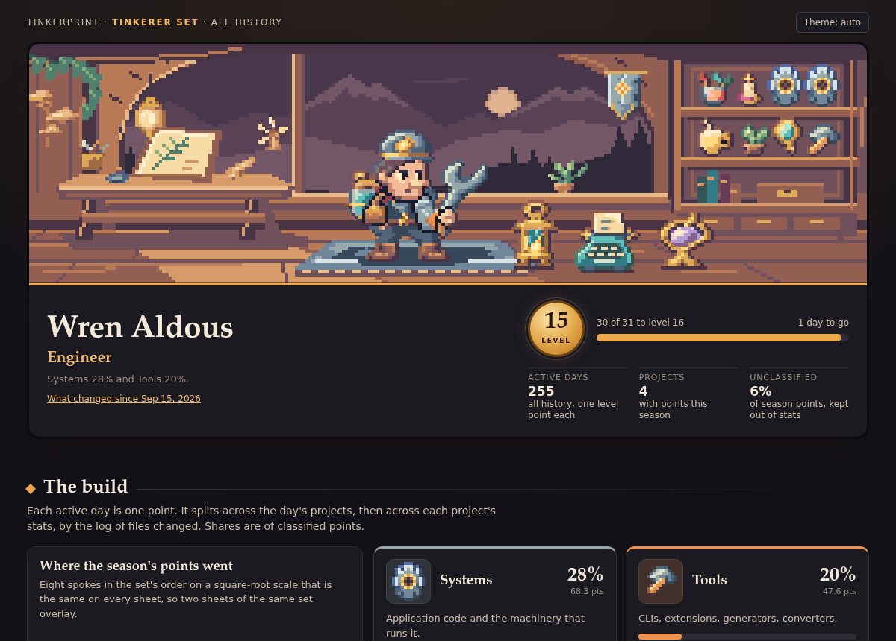

# tinkerprint

Turn your git history and your coding-agent logs into an RPG stat sheet.

Stats on a radar, a class from your two strongest stats with a pixel portrait to match, a level, a few dated achievements, a chronicle of your classes by quarter, and a party: the agents that worked beside you. It runs on your machine and reads only what is already there. Nothing is uploaded.

## What it makes

A private sheet, one HTML file per profile. Here are the demo's two invented people, a developer on the builder set and a tinkerer on the tinkerer set:




And a share card that carries only what you allow:


## Try it

Python 3.11 or newer. No other packages.

```
pip install .
tinkerprint demo --out tinkerprint-demo
```

The demo builds sheets for two invented people: a tinkerer with games, a bot and art tools, and a backend and web developer on the builder set. Open `sheet.html` in each folder.

For your own sheet:

```
tinkerprint init --out me.toml        # a commented starter profile
tinkerprint build --profile me.toml   # sheet.html, card.svg, sheet.json
tinkerprint audit --profile me.toml   # every text string in the built card.svg
```

`tinkerprint gallery --out art` writes one page with every class portrait of both sets, every familiar, icon and a few banners. The art is pixel art made in code from a pack of parts, and `--art-pack` swaps the pack. See [docs/ART.md](docs/ART.md).

`build` takes `--season FROM:TO` to set the season and `--as-of DATE` to ignore anything later. Without `--out`, sheets go to a folder under `~/.local/share/tinkerprint/sheets/` named for the profile file. Each build writes `sheet.json`, `changes.json`, `sheet.html` and `card.svg`, plus `portrait.png` when the card is on. `python -m tinkerprint` works too. See `examples/profile.example.toml` for every profile option.

## What it reads

- **git**: commits in the repos your profile lists, matched to you by name and email. Co-authored commits count. Bot authors never do.
- **Claude Code**: session transcripts under `~/.claude/projects/`. Timestamps, folders, models and the files a session edited. Never your prompts.
- **Codex CLI**: session logs under `~/.codex/sessions/`. When and where a session ran, its model, and the files its patches touched when the log records them.
- **Antigravity**: session summaries (experimental, off by default). Presence only.

## How it scores

Every day you changed something earns one point. That point splits across the projects you worked on that day, and each project feeds the stats its files and dependencies point to. Your level is the square root of your points. Agent sessions that edited nothing do not earn points. They show up in your party.

The full rules are in [METHOD.md](METHOD.md). Every sheet prints the method version that made it.

## Profiles

One person can keep several sheets. A profile says which folders and identities belong to it, and what names the sheet shows. A day-job profile next to a personal one makes a good comparison. Mark it `work = true` and it never makes a share card unless you allow it.

Each build saves its sheet outside every repo, under `~/.local/share/tinkerprint/`. The next build compares with the newest saved sheet from an earlier date and writes `changes.json`. The sheet shows what changed since then, with a link to it under your name. `sheet.json` never depends on that history: the same logs and profile give the same file.

## What it will not do

- Upload anything, or call any server.
- Read or store prompt text.
- Rank people, or say anything about skill, productivity or seniority. A sheet shows where your recorded time went, nothing more.

## Known limits

- Two builds that write to the same output folder at the same time can leave a mix of their files. Run one build per folder at a time.
- `audit` without `--out` reads the folder of the profile's last build. If another profile built into that folder later, it shows that card. Pass `--out` to audit a folder directly. That works even when the profile cannot be read.
- Where a daylight-saving change crosses the rollover hour, as in `Pacific/Chatham`, the edge of a day can move during that hour. Work near the change may land on the next or previous day.
- Two Codex records of one change that share no call id or item id count as two changes.
- Roots outside git take manifest priors from the files on disk, so their sheets can change with the checkout.

## Tests

```
python -m unittest discover -s tests
```

## License

MIT
