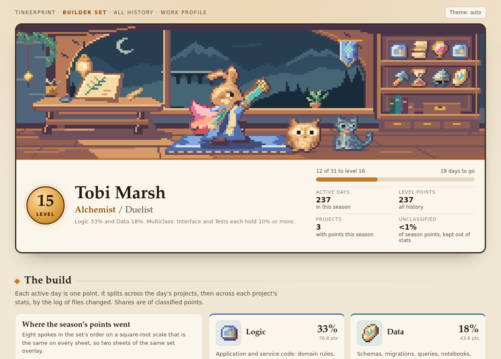
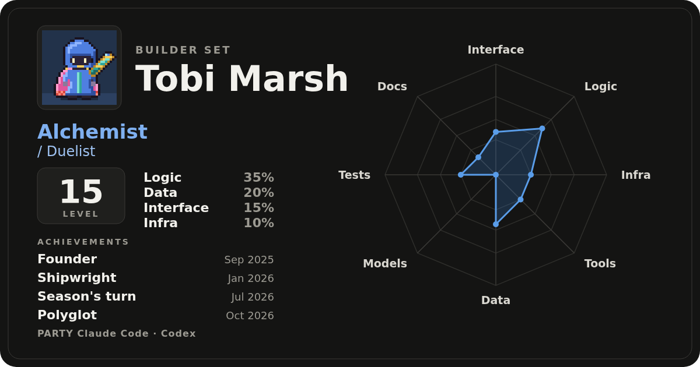

# tinkerprint

Turn your git history and your coding-agent logs into an RPG stat sheet.

Stats on a radar, a class from your two strongest stats with a pixel portrait to match, a level, a few dated achievements, a chronicle of your classes by quarter, and a party: the agents that worked beside you. It runs on your machine and reads only what is already there. Nothing is uploaded.

## What it makes

A private sheet, one HTML file per profile. Here are the demo's two invented people, a developer on the builder set and a tinkerer on the tinkerer set:




And a share card that carries only what you allow:



## Install

Python 3.11 or newer. It needs no other packages, apart from `tzdata` on Windows.

```
git clone https://github.com/exvanitas/tinkerprint
cd tinkerprint
pipx install .
```

`uv tool install .` works the same way. Or use a virtual environment:

```
python3 -m venv .venv
. .venv/bin/activate
pip install .
```

A bare `pip install .` outside a virtual environment is refused on current Debian, Ubuntu and Homebrew Python ("externally managed environment"). Use pipx, uv or a venv.

**Update:** `git pull` in the clone, then `pipx install --force .`, `uv tool install --reinstall .`, or `pip install .` in the venv.

**Uninstall:** run `tinkerprint forget --all --yes` first if you want the data folder gone (see [What stays on disk](#what-stays-on-disk)). Then `pipx uninstall tinkerprint`, `uv tool uninstall tinkerprint`, or delete the venv.

**Windows:** install the same way from PowerShell, for example `py -m pipx install .`, or a venv activated with `.venv\Scripts\activate`. pip adds `tzdata`, because Windows Python ships no time-zone data. `init` cannot read a time zone name on Windows, so it writes your clock's UTC offset: replace it with an IANA name like `"Europe/Berlin"` so daylight saving is right. Windows support is new and less tested than Linux and macOS.

## Try it

```
tinkerprint demo --out tinkerprint-demo
```

The demo builds sheets for two invented people: a tinkerer with games, a bot and art tools, and a backend and web developer on the builder set. Open `sheet.html` in each folder.

For your own sheet:

```
tinkerprint init      # writes tinkerprint.toml, with your name and email from git config
                      # then edit it: your other emails, and one [[project]] per project
tinkerprint build     # sheet.html, card.svg, sheet.json
tinkerprint audit     # every text string in the built card.svg
```

`build` and `audit` use `./tinkerprint.toml` when `--profile` is left out. Keep the profile outside your repos: it lists your folders and emails. A misspelled key, like `[[projects]]`, stops the build and names the right one.

`tinkerprint gallery --out art` writes one page with every class portrait of both sets, every familiar, icon and a few banners. The art is pixel art made in code from a pack of parts, and `--art-pack` swaps the pack. See [docs/ART.md](docs/ART.md).

`build` takes `--season FROM:TO` to set the season and `--as-of DATE` to ignore anything later. Without `--out`, sheets go to a folder under `~/.local/share/tinkerprint/sheets/` named for the profile file. Each build writes `sheet.json`, `changes.json`, `sheet.html` and `card.svg`, plus `portrait.png` when the card is on. `python -m tinkerprint` works too. See `examples/profile.example.toml` for every profile option.

## If your sheet is empty

A build that finds nothing still makes a sheet: level 0, Unclassed. It prints a warning for each cause it can see:

- **A root does not exist.** Fix `roots` in that `[[project]]`.
- **No commits match you.** The warning lists up to five authors seen in that repo, with their commit counts. Add yours to `emails` or `names` under `[identity]`. Commits made on GitHub's website use a noreply address like `12345+you@users.noreply.github.com`.
- **A root is a folder of repos.** Commits are read only from the repo a root is in. List each repo as a root.
- **A harness is on, but its folder is missing or has no sessions.** Set it to `false` under `[harnesses]`, or point `claude_dir`, `codex_dir` or `agy_db` at its logs.
- **git is not on PATH.** No commits can be read.
- **A harness changed its log format.** After each build a `Readers:` line per harness counts files, records, sessions and edits, with the log versions seen. It warns when logs hold no record it recognises, or many tool calls but no edit it knows. Update tinkerprint, and if that does not help, report that line. It holds counts and version numbers only.

Agent sessions in folders outside every root are unassigned and not scored. The build prints their totals. `--list-unassigned 20` lists up to 20 of the folders, so you can find roots you missed. Folder names stay off the screen unless you ask.

## What it reads

- **git**: commits in the repos your profile lists, matched to you by name and email. Co-authored commits count. Bot authors never do.
- **Claude Code**: session transcripts under `~/.claude/projects/`. Timestamps, folders, models and the files a session edited.
- **Codex CLI**: session logs under `~/.codex/sessions/`. When and where a session ran, its model, and the files its patches touched when the log records them.
- **Antigravity**: session summaries (experimental, off by default). Presence only.

The Claude Code and Codex readers parse each log line, prompts included, on your machine. They keep none of the prompt or message text. The git reader never reads commit subjects or bodies.

## How it scores

Every day you changed something earns one point. That point splits across the projects you worked on that day, and each project feeds the stats its files and dependencies point to. Your level is the square root of your points. Agent sessions that edited nothing do not earn points. They show up in your party.

The full rules are in [METHOD.md](METHOD.md). Every sheet prints the method version that made it.

## Profiles

One person can keep several sheets. A profile says which folders and identities belong to it, and what names the sheet shows. A day-job profile next to a personal one makes a good comparison. Mark it `work = true` and it never makes a share card unless you allow it.

Each build saves its sheet outside every repo, under `~/.local/share/tinkerprint/`. The next build compares with the newest saved sheet from an earlier date and writes `changes.json`. The sheet shows what changed since then, with a link to it under your name. When you changed the profile's projects, roots or identity in between, it says so, since the difference then includes history you added or removed. After an update that changes the method, it says the two sheets are not compared. `sheet.json` never depends on that history: the same logs, the same kept sessions from deleted logs and the same profile give the same file.

## What stays on disk

Everything tinkerprint keeps goes in its data folder: `~/.local/share/tinkerprint/`, or `$XDG_DATA_HOME/tinkerprint`, or `--data-dir`.

- `cache/`: what the readers kept from each agent log (times, folders, file paths, models), so the next build skips logs that have not changed. Shared by all profiles. When a log is deleted, as Claude Code does with transcripts after about a month, its entry stays here, marked gone, so its days still count. This is the only copy of those sessions.
- `history/`: each build's sheet, per profile and season, for "what changed".
- `last-build/`: one small file per profile naming its last output folder, for `audit`.
- `sheets/`: builds made without `--out`.
- `profiles.json`: which profile file each saved history belongs to, so history follows a profile file you move. Move it, then build before you edit it.

The cache, history, last-build files and `profiles.json` are private to you (mode 0600). The outputs, wherever they go, are readable under your umask (0644 on most systems), so a web server or a copy can serve them.

`tinkerprint forget` lists the shared cache and a profile's history and last-build file, and `--yes` deletes them. Deleting the cache loses the sessions kept from deleted logs. `forget --all` clears everything above. It deletes only files tinkerprint wrote, names any folder it leaves alone, and never touches your repos, agent logs, profiles or `--out` folders.

## What it will not do

- Upload anything, or call any server.
- Keep prompt or message text.
- Rank people, or say anything about skill, productivity or seniority. A sheet shows where your recorded time went, nothing more.

## Known limits

- Two builds that write to the same output folder at the same time can leave a mix of their files. Run one build per folder at a time.
- `audit` without `--out` reads the folder of the profile's last build. If another profile built into that folder later, it shows that card. Pass `--out` to audit a folder directly. That works even when the profile cannot be read.
- Where a daylight-saving change crosses the rollover hour, as in `Pacific/Chatham`, the edge of a day can move during that hour. Work near the change may land on the next or previous day.
- Two Codex records of one change that share no call id or item id count as two changes.
- Roots outside git take manifest priors from the files on disk, so their sheets can change with the checkout.

## Tests

```
python -m unittest discover -s tests
```

## License

MIT
